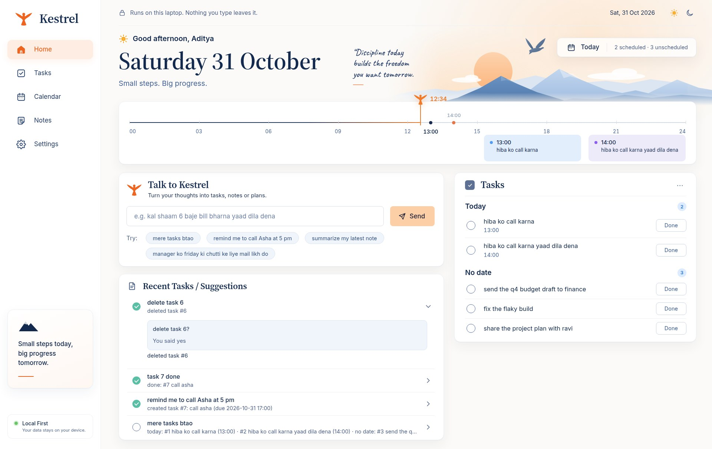

# Kestrel

A private assistant that runs on your own laptop. It keeps your tasks and reminds you, finds things in your notes and
documents, and writes mails and messages, in English and Hinglish. The language model runs on your device, so your
notes, documents and conversations go to no AI company.



**Status: early, and not released yet.** It is used daily on one Linux laptop. The macOS and Windows builds pass their
tests and compile, but nobody has run them as an app. See [What has not been tested](#what-has-not-been-tested).

## What it does

Type in your own words:

| For | Try |
|---|---|
| Tasks and reminders | `kal shaam 6 baje bill bharna yaad dila dena`, `mere tasks btao`, `bill bharna ho gaya`, `reschedule doctor to monday` |
| Your notes | `Q4 ka budget kitna hai`, `summarize my latest note`, `find my notes about budget`, `add this to notes: buy a lamp` |
| Documents in your notes folder | `mera PAN kahan hai`, `check my documents` (reminds you before an expiry date) |
| What you tell it | `my sister's name is Meera`, and later `meri behen ka naam kya hai` |
| Writing | `manager ko friday ki chutti ke liye mail likh do`, `rewrite this politely: send me the file now`, `translate to hindi: good morning` |
| Small Python code, run in a sandbox | `python mein factorial ka code likho` |
| Chat | `what is photosynthesis`, `start a new conversation` |
| Sending a mail (Gmail) | `anup ko mail kr do mai kl chutti pr hu`: it shows you the exact mail and sends it only after your yes |
| A ticket's PDF | `file this ticket ~/Downloads/ticket.pdf`: files it and sets a reminder for the journey |
| With the internet on | `my city is Kanpur`, `aaj mausam kaisa hai`, `news dikhao`, `search the web for ...`, `research ...`, `morning brief` |
| Asking how it answered | `why this answer` |

Settings lists what works on your device, what needs a setup step, and what your device cannot do and why.

## How it treats your data

- **No AI company gets your data.** Models run on the device.
- **The core has no network code.** Every internet request goes through one small separate program, `kestrel-net`.
  `scripts/check_core_no_network.sh` fails the build if the core links a network client.
- **The internet is off until you turn it on,** and everything that goes out is listed in Settings.
- **Nothing is sent without your yes.** A mail is shown exactly as it will leave, and goes only to people in your contacts.
- **What a web page says is only shown,** and never acted on.
- **Your data stays in files you can see, export and delete.** A Gmail app password goes in your system's keyring and in
  no file of Kestrel's.

With the internet on, a web search sends your words to the search service you chose, and a mail goes through Gmail.

## Build and install

There are no public installers yet, so you build it. Allow 10 to 20 minutes the first time, while `llama.cpp` compiles.
You need [Rust](https://rustup.rs) (the repository pins its version), CMake and a C++ compiler.

On Linux, also the app's system packages:

```sh
# Ubuntu or Debian
sudo apt install libwebkit2gtk-4.1-dev libayatana-appindicator3-dev librsvg2-dev libxdo-dev libssl-dev
# Fedora (what the author's laptop has)
sudo dnf install webkit2gtk4.1-devel gtk3-devel librsvg2-devel openssl-devel cmake clang
```

Then:

```sh
git clone https://github.com/adi-mauryaji/Kestrel.git
cd Kestrel

# Files too big for git: the sentence encoder and its trained heads (121 MiB)
curl -fLO https://github.com/adi-mauryaji/Kestrel/releases/download/models-v1/kestrel-ci-assets-v1.tar.gz
echo "938cfffb9c04073a13a4eb725776fd6fc815720c43cb0620e3ac307390a8c1cf  kestrel-ci-assets-v1.tar.gz" | sha256sum -c
tar -xzf kestrel-ci-assets-v1.tar.gz && rm kestrel-ci-assets-v1.tar.gz

cargo install tauri-cli --version =2.12.3 --locked
scripts/build_desktop.sh --bundles deb    # or rpm; dmg on macOS; nsis on Windows, in Git Bash
```

The installer lands in `apps/desktop/target/release/bundle/`. On macOS use `shasum -a 256 -c` for the check above.

```sh
sudo apt install ./apps/desktop/target/release/bundle/deb/Kestrel_*.deb
# or: sudo dnf install ./apps/desktop/target/release/bundle/rpm/Kestrel-*.rpm
```

**The first open** asks your name, shows your notes folder, and offers the default model, Gemma 4 E2B (2.84 GB): turn the
internet on there and press **Download**. It continues if it stops, and keeps the file only if its SHA-256 is right. You
can then turn the internet off again. Then press **Measure speed** (1 to 2 minutes): what needs the model shows as ready
only once your device has been measured.

Reminders need Kestrel running. Closing the window leaves it near the clock; its icon has **Start at login**.

**To update,** Quit from that icon first. Installing over a running app changes nothing until it restarts, and the page
says so.

How to uninstall, and how to run an unsigned build on macOS or Windows, is in [the guide](docs/v4/pilot/guide.md).

## How it runs

Measured on one laptop (Ryzen 5 5500U, 14 GB, no GPU), once: [the numbers](docs/v4/KESTREL_V4_BLUEPRINT.md#7-performance-budgets-tested).

| | |
|---|---|
| Rules and encoder decide | 13 ms or less |
| First words, new conversation | 1.6 s |
| First words, inside a conversation | 3 to 5 s (the target of 2 s is missed) |
| A mail of about 300 tokens | 22 s |
| The first answers ever | up to about a minute, once per model and device |
| Memory, no model loaded | 268 MiB |
| Memory, model loaded | 1.5 GiB of its own, plus 2.7 GiB of file pages the system can take back |

The model unloads after 10 idle minutes. It should fit 8 GB of memory and about 5 GB of disk, but that is an estimate:
no 8 GB laptop has been measured.

## What has not been tested

- **macOS and Windows as apps.** Tests and builds pass on CI. Nobody has opened them, and page checks have not run in
  their webviews.
- **A fresh install on another machine,** and any laptop with less than 14 GB.
- **A real train or flight ticket.** Ticket filing has run only on made-up PDFs.
- **A real SearXNG** (search has used a stand-in provider, [how to set one up](docs/v4/SEARXNG.md)) and
  **[the phone page through Tailscale](docs/v4/PHONE.md).**

Known rough edges: PDFs in Hindi lose joined letters, and scanned PDFs give no text. Answers come from a small model, and
they can be wrong.

## Develop

No model or extra file is needed for these:

```sh
cargo fmt --all -- --check
cargo clippy --workspace --all-targets -- -D warnings
cargo test --workspace
scripts/check_core_no_network.sh
```

With the encoder files from above and `--features llama`:

```sh
cargo clippy -p kestrel-cli --all-targets --features llama -- -D warnings
python3 scripts/preview_page.py    # the page with demo data, on scratch folders
```

| Where | What |
|---|---|
| `apps/cli` | the service and the `kestrel` command; `web/page.html` is the whole page |
| `apps/net` | `kestrel-net`, the only program with a network client |
| `apps/desktop` | the Tauri app: window, tray, notifications, installers |
| `crates/` | routing, memory, tools, the code sandbox, device capabilities, platform differences |
| `capabilities/` | one file for each thing Kestrel can do on a device, and what that needs |
| `experiments/v4/` | checks that drive the real page; `app_test.py --engine webkit` says `app_scenario.json` in the Linux app's own engine |
| [`docs/v4/KESTREL_V4_BLUEPRINT.md`](docs/v4/KESTREL_V4_BLUEPRINT.md) | the architecture and the rules every change keeps |

The Linux app runs WebKitGTK, and a bug has hidden between it and Chrome: run what you change in that engine too. macOS
and Windows have their own webviews, unchecked so far.

## Other versions and the research

This branch, `feat/v4`, is the current one. `main` is v1, `feat/stage2-daily-use` is v2, and `feat/v3` is v3, which runs
on one laptop and is frozen.

The project began as a study: a pre-registered evaluation of calibrated cascade routing on a laptop, where keyword rules
go first, then a small encoder, and the language model only when the cheaper tiers are not confident. See
[`experiments/PREREG.md`](experiments/PREREG.md), [`RESULTS.md`](experiments/RESULTS.md),
[`LIMITATIONS.md`](experiments/LIMITATIONS.md) and [`README_REPRO.md`](experiments/README_REPRO.md). Its last experiment
is not finished.

## Licence

The code is under `MIT OR Apache-2.0`, as `Cargo.toml` says. Models have their own licences.
